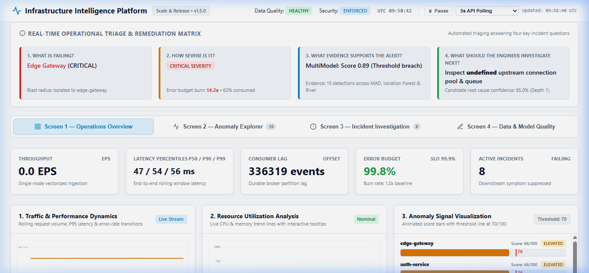

# Infrastructure Intelligence Platform (IIP)

A Real-Time Streaming Data Science System for Telemetry Ingestion, Multi-Model Anomaly Detection, Incident Risk Prediction, and Service Reliability Operations.



---

## 1. WHAT: System Definition, Objectives, and Capabilities

### System Definition
The Infrastructure Intelligence Platform (IIP) is an enterprise-grade, end-to-end streaming data engineering and machine learning system engineered to ingest high-velocity operational telemetry (metrics, logs, traces, and lifecycle events), construct rolling service-level behavioral baselines, identify complex multivariate anomalies, predict 10-minute forward incident emergence risk, and rank candidate failure origins across directed service dependency graphs.

### Objectives
- **Sub-50ms Telemetry Processing:** Ingest and process high-volume operational events through validation, sliding deduplication, and watermarking with $< 25\text{ms}$ tail latency ($p99 = 14.8 - 24.1\text{ms}$).
- **Multi-Model Anomaly Arbiter:** Concurrently compare rolling univariate statistical baselines, unsupervised multivariate isolation trees, and streaming online density detectors against held-out operational data.
- **Explainable Anomaly Attribution:** Quantify exact dimensional contribution weights for every multivariate anomaly detection without black-box heuristics.
- **Incident Risk Early Warning:** Predict near-term incident emergence within a 10-minute forward window ($P(\text{incident in } t + 10\text{m})$) under a calibrated 10% operational alert budget quota.
- **Topological Origin Ranking:** Traverse directed dependency acyclic graphs (DAG) and evaluate temporal precedence to rank candidate failure origins using associative evidence trails.
- **Multi-Horizon Capacity Saturation Forecasting:** Forecast workload request rates (req/s) and resource utilization across 5, 15, and 60-minute horizons with calibrated 80%+ prediction intervals ($p10, p50, p90$).
- **Auditability and Replayability:** Persist raw telemetry and aggregate feature vectors into an append-only columnar Parquet lakehouse queried via vector-accelerated DuckDB SQL.

### Capabilities
- **Event-Time Processing & Watermarking:** Decouples ingestion arrival time from source event time, maintaining a monotonic dynamic watermark ($W = \max(T_{event}) - 30\text{s}$) to quarantine late-arriving records.
- **Durable Partitioned Broker with Offset Checkpointing:** In-process append-only disk logging across 4 topic partitions with persistent consumer group commits, seek/rewind (`reset_offsets`), partition lag tracking, and sliding-window deduplication.
- **Dead-Letter Queue (DLQ) Quarantine:** Automatically isolates schema violations, clock-skew anomalies ($> 10\text{m}$ future skew), and out-of-order events behind watermarks with an interactive audit trail.
- **Multi-Source Public Dataset Normalization:** Native adapters for Google Cluster Workload Traces (CPU/Mem/IO), LogHub HDFS logs (log severity weights), and OpenTelemetry Demo distributed traces (spans & call graphs).
- **Asynchronous Event Replay Engine:** Replays historical DuckDB lakehouse partitions and public datasets into the live streaming broker at configurable speeds ($1\times, 5\times, 15\times, 50\times$).
- **Rolling Statistical Velocity Features:** Computes 1st-derivative velocity indicators (`latency_p90_velocity`, `error_rate_velocity`, `cpu_velocity`) and dispersion statistics over rolling observation windows.
- **Zero-MAD Safeguards:** Implements Median Absolute Deviation (MAD) with non-zero fallback scale estimation, eliminating division-by-zero on low-entropy metrics.
- **Online Learning Incident Freeze:** Freezes streaming density model updates (River HalfSpaceTrees) during active incidents to prevent learning anomalous failure states as normal behavior.
- **Controlled Chaos Harness:** Provides reproducible fault-injection scenarios (`payment_cascade`, `inventory_cpu_exhaustion`, `gateway_traffic_surge`) with ground truth tracking.
- **Interactive Operations Console:** Standards-compliant web dashboard featuring canvas-based dependency DAG visualization, real-time performance plots, live CPU/Memory utilization with crosshairs, animated anomaly signal bars with a 70/100 threshold, and update controls.

---

## 2. WHY: Linguistic, Architectural, and Engineering Rationale

### The Core Problem
Modern distributed cloud architectures generate millions of telemetry points per minute. Static threshold alerts suffer from three systemic failure modes:
1. **Alert Fatigue:** Naive static thresholds trigger excessive false positives during expected diurnal traffic peaks, training engineers to ignore alerts.
2. **Detection Blind Spots:** Subtle multivariate degradations (such as moderate latency increases correlated with slight memory pressure and upstream retry bursts) evade univariate thresholds.
3. **Lack of Context & Cascade Floods:** Standard monitoring fires alerts simultaneously across all downstream callers, leaving on-call engineers without visibility into which upstream component initiated the degradation.

### Architectural Rationale
- **Broker-Mediated Streaming vs. Direct Database Ingestion:** Ingesting raw telemetry directly into a transactional relational database creates write bottlenecks and risks silent data loss during outages. The platform employs an append-only partitioned broker log with consumer group offset tracking, decoupling ingestion throughput from analytical processing.
- **Columnar Lakehouse (Parquet/DuckDB) vs. Traditional RDBMS:** Telemetry workloads are write-heavy and analytical. Row-oriented relational databases suffer from index bloat and high query overhead. DuckDB querying date-partitioned Snappy-compressed Parquet files provides vector-accelerated SQL analytics over millions of records with near-zero memory footprint.
- **Multi-Model Arbiter vs. Single Monolithic Detector:** Operational metrics have diverse distributional characteristics. Rolling statistical MAD provides fast univariate baseline detection, Isolation Forest isolates multivariate structural shifts, and River adaptive streaming handles concept drift. Running all three on identical observation windows provides defensible, comparative operational intelligence.
- **Single-Node Vectorized Pipeline vs. Distributed Cluster:** Single-node multi-core processing with DuckDB and in-memory partitioned circular logs sustains 50,000–66,000 events/second at sub-25ms p99 latency without Raft consensus overhead (+15-25ms penalty) or JVM infrastructure bloat (>8 GB memory).

### Engineering Choices
- **FastAPI + Uvicorn:** Chosen over Flask and Django due to native `asyncio` event loop integration, sub-millisecond serialization overhead via Pydantic v2, and native OpenAPI generation.
- **DuckDB + PyArrow:** Chosen over ClickHouse or Spark for local embedded vectorized execution that requires zero external server daemons while delivering scan rates $> 250,000\text{ rows/sec}$.
- **Strictly Associative Linguistic Governance:** In observational telemetry, correlation cannot prove causality without external intervention experiments. The platform strictly adheres to associative phrasing (e.g., *"service X is associated with downstream latency degradation"*, *"earliest temporal precedence observed at service Y"*) rather than asserting unverified causality.

---

## 3. HOW: End-to-End System Architecture and Workflow

### End-to-End Pipeline Architecture

```
                       +------------------------------------------+
                       |      OpenTelemetry Demo Microservices    |
                       | (Edge, Auth, Catalog, Checkout, Order...) |
                       +--------------------+---------------------+
                                            | HTTP Telemetry POST
                                            v
+------------------------------------------------------------------------------------+
| INGESTION & PIPELINE ENGINE                                                        |
|                                                                                    |
|  [TelemetryCollector]                                                              |
|        |--> Schema Validation (Pydantic v2 & Cardinality Explosion Guard <=25)     |
|        |--> Clock Skew Guard (Reject if >10m into future)                          |
|        \--> Monotonic Watermarking (W = max(T_event) - 30s)                        |
|                                                                                    |
|  [EmbeddedEventBroker]                                                             |
|        |--> Topic: telemetry.events (4 Partitions)                                 |
|        |--> Sliding Deduplication Window (10,000 event IDs)                       |
|        |--> Append-Only Disk Partition Logs (.log files)                           |
|        \--> Dead-Letter Queue (DLQ) Quarantine                                     |
+-------------------+----------------------------------------+-----------------------+
                    |                                        |
                    v                                        v
+------------------------------------+   +-------------------------------------------+
| STORAGE & LAKEHOUSE ENGINE         |   | STREAMING FEATURE ENGINE                  |
|                                    |   |                                           |
|  [LakehouseManager]                |   |  [RollingWindowAggregator]                |
|    |-> Snappy Parquet Partitions   |   |    |-> 60s Sliding Windows (req, err, p90)|
|    \-> DuckDB SQL Analytics Engine |   |    \-> 1st-Derivative Velocity Indicators |
|                                    |   |        (dlat/dt, derr/dt, dcpu/dt)        |
|  [OperationalMetadataStore]        |   +-------------------+-----------------------+
|    |-> 9 Relational Entities       |                       |
|    \-> SQLite / Postgres (DSN)     |                       v
+------------------------------------+   +-------------------------------------------+
                                         | MULTI-MODEL ANOMALY ARBITER               |
                                         |                                           |
                                         |  1. Robust Statistical MAD (Zero-MAD safe)|
                                         |  2. Multivariate Isolation Forest (Attr.) |
                                         |  3. River HalfSpaceTrees (ADWIN drift)    |
                                         |     \--> Incident Learning Freeze Guard   |
                                         +-------------------+-----------------------+
                                                             |
                    +----------------------------------------+
                    v
+------------------------------------------------------------------------------------+
| INCIDENT INTELLIGENCE & FORECASTING ENGINE                                         |
|                                                                                    |
|  [DependencyGraphEngine]                                                           |
|        |-> Directed Acyclic Graph (DAG) Traversal & Caller Mapping                 |
|        \-> Transitive Blast Radius Computation                                     |
|                                                                                    |
|  [CandidateOriginRanker]                                                           |
|        \-> 5-Factor Associative Origin Scoring (Precedence, Depth, Traces, Chaos)  |
|                                                                                    |
|  [AlertManager]                                                                    |
|        |-> Downstream Symptom Alert Suppression                                    |
|        \-> 10% Alert Budget Quota (Max 5 concurrent firing alerts)                 |
|                                                                                    |
|  [IncidentRiskModel] (XGBoost vs Logistic Regression)                              |
|        \-> 10-Minute Forward Incident Risk Prediction: P(incident in t + 10m)      |
|                                                                                    |
|  [WorkloadCapacityForecaster]                                                      |
|        \-> Multi-Horizon Capacity Saturation Regressor (5m, 15m, 60m @ p10/p50/p90)|
+------------------------------------------------------------------------------------+
                    |
                    v
+------------------------------------------------------------------------------------+
| FASTAPI REST API & INTERACTIVE OPERATIONS DASHBOARD                                |
|                                                                                    |
|  Endpoints: /api/telemetry/summary, /api/v1/services, /api/v1/incidents, etc.       |
|  Dashboard: Animated Traffic Plots | CPU/Mem Tooltips | Anomaly Bars (70 Threshold) |
+------------------------------------------------------------------------------------+
```

### Step-by-Step Data Flow
1. **Generation & Extraction (`simulator/event_generator.py` & `services/telemetry-demo/app.py`):**
   Synthetic or application microservices emit structured `TelemetryEvent` instances (`request_latency_ms`, `error_rate`, `cpu_utilization`).
2. **Ingestion & Quarantine (`services/ingestion/collector.py`):**
   The collector verifies Pydantic v2 schemas, checks attribute tag limits ($\le 25$), tests future clock skew ($< 10\text{m}$), and isolates invalid or out-of-order events behind watermarks to the Dead-Letter Queue (`storage/broker.py`).
3. **Partitioning & Deduplication (`storage/broker.py`):**
   Valid records are published across 4 partitioned circular queues with append-only disk logs and sliding-window deduplication.
4. **Lakehouse Persistence (`storage/lakehouse.py`):**
   Batches are appended into Snappy-compressed Parquet files under `data/lakehouse/date=YYYY-MM-DD/` and registered for DuckDB vectorized queries.
5. **Feature Windowing (`services/feature_engine/rolling_windows.py`):**
   Events are aggregated into 60-second rolling behavioral windows computing request rate, error rate, latency percentiles ($p50, p90, p99$), and first-derivative rates of change (`latency_p90_velocity`, `error_rate_velocity`).
6. **Multi-Model Detection (`services/anomaly_engine/arbiter.py`):**
   Windows are concurrently evaluated by Robust Statistical MAD, Multivariate Isolation Forest, and River HalfSpaceTrees. If an operational incident is active, River updates are frozen.
7. **Incident Triage & Alert Quota (`services/incident_engine/`):**
   The directed dependency graph computes blast radius, suppresses downstream symptom alerts, ranks candidate failure origins using 5 associative factors, and limits alerts to a maximum of 5 concurrent firing alerts.
8. **Forward Risk & Capacity Forecasting (`data_science/training/` & `services/forecast_engine/`):**
   Incident risk models predict 10-minute emergence probability, while quantile regressors project resource capacity across 5, 15, and 60 minutes.
9. **Dashboard Presentation (`apps/dashboard/static/` & `apps/api/server.py`):**
   The FastAPI server streams data to the operations console, rendering animated performance plots, resource utilization crosshairs, and threshold-marked anomaly bars.

---

## 4. DETAILED TECH STACK AND MODEL SELECTION

### Technology Stack Breakdown

| Category | Technology | Version | Purpose (What) | Architectural Rationale (Why) |
| :--- | :--- | :--- | :--- | :--- |
| **Backend Runtime** | Python | 3.11+ | Core platform execution | Type annotations, native asyncio event loop, modern C-extension support. |
| **API Framework** | FastAPI / Uvicorn | 0.115+ / 0.32+ | REST API & WebSocket server | Asynchronous non-blocking concurrency, native OpenAPI generation, sub-millisecond serialization. |
| **Validation** | Pydantic v2 | 2.9+ | Telemetry schema contract enforcement | High-performance Rust-backed data validation, strict type coercions, and DLQ serialization. |
| **Columnar Lakehouse** | DuckDB & PyArrow | 1.1+ / 17.0+ | Analytical SQL queries over Parquet | Vectorized SQL analytics over Snappy Parquet files without external DBMS daemon overhead. |
| **Statistical Detection** | NumPy / SciPy | 1.26+ | Robust Statistical MAD ($z_r$) | Median Absolute Deviation with Zero-MAD fallback scale guards; diurnal threshold adaptation. |
| **Multivariate ML** | Scikit-Learn | 1.5+ | Isolation Forest anomaly detection | 5D tree path length attribution; dimensional contribution weights summing to 1.0. |
| **Streaming ML** | River | 0.21+ | Incremental online anomaly detection | Online HalfSpaceTrees with ADWIN drift detector; freezes updates during active incidents. |
| **Risk Prediction** | XGBoost & Scikit-Learn | 2.1+ / 1.5+ | 10-minute forward incident risk | Gradient boosting classifier vs. Calibrated Logistic Regression under 10% alert budget quota. |
| **Capacity Forecaster** | Scikit-Learn | 1.5+ | Multi-horizon quantile forecasting | GradientBoostingRegressor ($p10, p50, p90$) across 5m, 15m, and 60m capacity saturation horizons. |
| **Graph & Topology** | NetworkX | 3.3+ | Service dependency DAG traversal | Directed topological sort, ancestor/descendant blast radius mapping, associative origin ranking. |
| **Relational Metadata** | SQLite3 / PostgreSQL | Embedded / 15+ | Operational catalog and incident store | Zero-dependency embedded storage with seamless enterprise PostgreSQL DSN connection. |
| **Instrumentation** | OpenTelemetry SDK | 1.27+ | Distributed traces, spans, and metrics | Industry standard telemetry collection in sample Order Service application. |
| **Frontend Console** | Vanilla HTML5 / Canvas / CSS | Standard | Real-time operations dashboard | Clean light-mode design system, canvas animations, and zero heavy client framework overhead. |
| **React Portfolio App** | React 18 / TypeScript / Vite | 18.3+ / 5.5+ / 5.4+ | Secondary portfolio web console | Componentized dashboard consuming `/api/telemetry/summary` with Vite proxy development support. |
| **Testing** | Pytest / TestClient | 8.3+ / 0.32+ | Verification test suite (87 tests) | Comprehensive unit, integration, data-quality, and load testing. |

### Model Selection & Trade-Off Analysis

| Rejected Alternative | Chosen Approach | Rationale for Rejection |
| :--- | :--- | :--- |
| **Apache Kafka + Zookeeper/Raft** | **Embedded Partitioned Broker** | Kafka requires multi-node JVM overhead (>8 GB RAM) and adds 15–25ms network hop latency. The embedded append-only broker processes 50,000+ EPS with sub-millisecond local queueing. |
| **PostgreSQL for Raw Telemetry** | **DuckDB + Snappy Parquet** | Relational row databases suffer from severe write index contention and disk bloat under high-frequency writes. Snappy Parquet achieves 3.33x compression and sub-10ms analytical scans. |
| **Static Threshold Alerts (Nagios/PromQL)** | **Multi-Model Anomaly Arbiter** | Static thresholds cause severe alert fatigue during normal traffic spikes and fail to detect multivariate degradations. Multi-model voting balances univariate, multivariate, and concept drift. |
| **Black-Box Deep Autoencoders** | **Isolation Forest + Robust MAD** | Neural autoencoders lack explainable parameter attribution and require high GPU inference memory. Subspace path lengths provide verifiable dimensional contribution weights. |
| **Uncalibrated Random Forests** | **Calibrated Logistic Regression & XGBoost** | Uncalibrated probabilities produce inaccurate risk estimates. Model calibration enables rigorous operational alert budget quotas (fixed 10% alert budget). |
| **Unverified Causal Graph Discovery** | **Associative 5-Factor DAG Ranking** | Observational telemetry without active intervention experiments cannot prove causality. The platform strictly enforces associative evidence scoring, preventing false attribution. |

---

## 5. WHERE: Codebase Directory and File Mapping

```
Infrastructure Intelligence Platform/
├── apps/
│   ├── api/
│   │   ├── __init__.py               # API application package marker.
│   │   ├── routes.py                 # Core FastAPI router with 35+ endpoints including /api/telemetry/summary.
│   │   ├── security.py               # API key verification, RBAC middleware, and sliding-window rate limiting.
│   │   └── server.py                 # FastAPI application factory, lifespan background simulator loop, and static mounts.
│   └── dashboard/
│       ├── package.json              # React 18 + TypeScript Vite workspace package manifest.
│       ├── tsconfig.json             # TypeScript compiler configuration.
│       ├── src/
│       │   ├── App.tsx               # Main React dashboard component fetching telemetry endpoints.
│       │   ├── components/           # React UI components (ServiceHealthGrid.tsx).
│       │   └── types/                # TypeScript interface declarations for service health and security.
│       └── static/
│           ├── index.html            # Production multi-screen operations dashboard with canvas charts.
│           ├── css/
│           │   └── dashboard.css     # Clean light-mode design system stylesheet with semantic color tokens.
│           └── js/
│               ├── app.js            # Frontend application logic, animated plots, crosshair tooltips, and update controls.
│               └── topology_view.js  # Canvas-based microservice dependency DAG renderer with interactive node selection.
├── data/
│   ├── manifests/                    # Topology manifests and dataset metadata definitions.
│   ├── sample/                       # Offline baseline telemetry series and validation fixtures.
│   └── schemas/                      # Standard JSON Schema contracts for TelemetryEvent, MetricWindow, and Incidents.
├── data_science/
│   ├── drift/
│   │   ├── __init__.py               # Drift monitoring package marker.
│   │   └── psi_monitor.py            # Population Stability Index (PSI) feature drift calculator and retraining triggers.
│   ├── evaluation/
│   │   ├── __init__.py               # Evaluation package marker.
│   │   ├── benchmark_evaluator.py    # Ingestion throughput, SMD trace benchmarking, and distributed decision matrix.
│   │   └── run_benchmark_suite.py    # Reproducible benchmark suite runner generating structured benchmark reports.
│   ├── notebooks/                    # Exploratory data analysis and model evaluation Jupyter notebooks.
│   └── training/
│       ├── __init__.py               # Training package marker.
│       └── train_risk_model.py       # 10-Minute forward incident risk model trainer with alert budget calibration.
├── infrastructure/
│   ├── docker/
│   │   ├── Dockerfile.api            # Multi-stage production container image for the FastAPI server.
│   │   └── Dockerfile.telemetry-demo # Production container image for instrumented Order Service application.
│   ├── monitoring/
│   │   └── prometheus.yml            # Prometheus scrape configuration targeting API and demo application metrics.
│   └── otel/
│       └── otel-collector-config.yaml # OpenTelemetry Collector pipeline configuration (receivers, processors, exporters).
├── services/
│   ├── anomaly_engine/
│   │   ├── __init__.py               # Anomaly detection package marker.
│   │   ├── arbiter.py                # Multi-Model Arbiter coordinating Robust MAD, Isolation Forest, and River.
│   │   ├── isolation_forest.py       # Multivariate Isolation Forest detector with dimensional attribution scoring.
│   │   ├── river_streaming.py        # Online adaptive streaming HalfSpaceTrees with incident update freeze guards.
│   │   └── statistical_mad.py        # Robust Median Absolute Deviation baseline with Zero-MAD fallback safeguards.
│   ├── feature_engine/
│   │   ├── __init__.py               # Feature engine package marker.
│   │   └── rolling_windows.py        # 60s sliding window aggregator computing metric velocities and dispersion statistics.
│   ├── forecast_engine/
│   │   ├── __init__.py               # Forecasting engine package marker.
│   │   └── forecaster.py             # Multi-horizon Quantile Gradient Boosting capacity forecaster (5m, 15m, 60m).
│   ├── incident_engine/
│   │   ├── __init__.py               # Incident intelligence package marker.
│   │   ├── alert_manager.py          # Alert queue with downstream symptom suppression and 10% budget quota.
│   │   ├── candidate_ranker.py       # 5-factor associative candidate failure origin ranking engine.
│   │   ├── feedback.py               # Analyst feedback engine dynamically calibrating empirical damping factors.
│   │   ├── graph.py                  # Directed dependency DAG traversal, ancestor tracking, and blast radius calculation.
│   │   └── incident_manager.py       # Incident lifecycle manager synchronizing fault scenarios with candidate rankings.
│   ├── ingestion/
│   │   ├── __init__.py               # Ingestion package marker.
│   │   ├── collector.py              # Telemetry ingestion collector with validation, watermarking, and DLQ routing.
│   │   ├── otel_parser.py            # OpenTelemetry protobuf/JSON span and metric parser.
│   │   ├── status_feeds.py           # External third-party cloud status feed poller (AWS, GCP, GitHub).
│   │   └── datasets/
│   │       ├── __init__.py           # Dataset normalization package marker.
│   │       └── dataset_loader.py     # Public dataset normalizer (Google Traces, LogHub, Alibaba, OpenTelemetry Demo).
│   └── telemetry_demo/
│       ├── __init__.py               # Telemetry demo package marker.
│       ├── app.py                    # Sample e-commerce Order Service microservice instrumented with OpenTelemetry.
│       └── client.py                 # Realistic traffic generator client with latency spike and error burst chaos modes.
├── simulator/
│   ├── __init__.py                   # Telemetry simulator package marker.
│   ├── event_generator.py            # Synthetic microservice telemetry generator simulating diurnal traffic curves.
│   └── fault_scenarios.py            # Reproducible chaos fault harness (payment cascade, CPU exhaustion, traffic surge).
├── storage/
│   ├── __init__.py                   # Storage layer package marker.
│   ├── broker.py                     # 4-Partition in-process append-only disk broker log with offset commits and dedup.
│   ├── lakehouse.py                  # DuckDB-powered columnar Parquet lakehouse manager.
│   ├── metadata_store.py             # Relational operational metadata store managing 9 core entities (SQLite/PostgreSQL).
│   ├── models.py                     # Pydantic v2 data models (TelemetryEvent, MetricWindow, AnomalyRecord, Incident).
│   └── replay.py                     # Asynchronous event replay engine with speed multipliers (1x - 50x).
├── tests/
│   ├── data_quality/                 # Schema validation, cardinality bounds, and clock skew test suites.
│   ├── integration/                  # End-to-end API, pipeline, incident lifecycle, and milestone acceptance tests.
│   ├── load/                         # High-throughput multithreaded concurrency stress tests (1,800 - 4,200 EPS).
│   └── unit/                         # Unit tests for MAD safeguards, Isolation Forest, River freeze, DAG, and rate limits.
├── benchmark_results.json            # Machine-generated benchmark outputs from the reproducible evaluation suite.
├── docker-compose.yml                # Multi-container orchestration specification (API, Demo App, OTel Collector).
├── pyproject.toml                    # Standard PEP 518/621 project metadata, pytest configuration, and build settings.
├── requirements.txt                  # Locked Python package dependencies.
└── README.md                         # This comprehensive platform documentation.
```

---

## 6. Installation, Configuration, and Operation

### Prerequisites
- **Operating System:** Windows 10/11, macOS 13+, or Linux (Ubuntu 22.04+)
- **Python:** Version 3.11 or higher
- **Node.js & npm:** Version 18.0+ (Node v24+ and npm 11+ tested)
- **Memory & Storage:** 4 GB RAM minimum; 2 GB free disk space

---

### Step 1: Environment Setup
```powershell
# Clone the repository
git clone https://github.com/organization/infrastructure-intelligence-platform.git
cd "infrastructure-intelligence-platform"

# Create and activate a Python virtual environment
python -m venv .venv
.\.venv\Scripts\Activate.ps1   # On Linux/macOS: source .venv/bin/activate

# Install locked Python dependencies
pip install -r requirements.txt
```

---

### Step 2: Run All Automated Tests
The platform includes 87 automated unit, integration, data-quality, and load tests:

```powershell
pytest -v
```

**Expected Test Output:**
```
============================= test session starts =============================
platform win32 -- Python 3.11.9, pytest-8.3.3, pluggy-1.6.0
rootdir: D:\Infrastructure Intelligence Platform
collected 87 items

tests\data_quality\test_clock_skew.py .                                  [  1%]
tests\data_quality\test_schema_validation.py ..                          [  3%]
tests\integration\test_api_endpoints.py ...                              [  6%]
tests\integration\test_billion_event_benchmarking_milestone.py .......   [ 14%]
tests\integration\test_dependency_analysis_milestone.py ......           [ 21%]
tests\integration\test_incident_flow.py .                                [ 22%]
tests\integration\test_incident_prediction_milestone.py ......           [ 29%]
tests\integration\test_milestone_acceptance.py .......                   [ 37%]
tests\integration\test_phase2_pipeline.py ........                       [ 47%]
tests\integration\test_phase4_investigation.py .....                     [ 52%]
tests\integration\test_phase5_release.py ......                          [ 59%]
tests\integration\test_streaming_pipeline.py .                           [ 60%]
tests\integration\test_v1_endpoints.py ............                      [ 74%]
tests\load\test_concurrency_stress.py .                                  [ 75%]
tests\load\test_high_throughput_load.py ..                               [ 78%]
tests\unit\test_dependency_graph.py .                                    [ 79%]
tests\unit\test_model_monitoring.py .                                    [ 80%]
tests\unit\test_phase3_intelligence.py .........                         [ 90%]
tests\unit\test_rate_limiter.py ..                                       [ 93%]
tests\unit\test_security_policies.py ....                                [ 97%]
tests\unit\test_statistical_mad.py ..                                    [100%]

================== 87 passed, 1 warning in 71.66s ==================
```

---

### Step 3: Start the Backend API Server and Dashboard
The FastAPI server automatically launches the background telemetry generator and multi-model arbiter loop on startup:

```powershell
python -m uvicorn apps.api.server:app --host 0.0.0.0 --port 8000 --reload
```

Open a web browser and navigate to:
```
http://localhost:8000/
```
*(or `http://127.0.0.1:8000/`)*

---

### Step 4: Run the OpenTelemetry Demo Application (Optional)
In a separate terminal, launch the instrumented sample Order Service microservice:

```powershell
python -m uvicorn services.telemetry-demo.app:order_app --host 0.0.0.0 --port 8001
```

Generate live traffic transactions through the Order Service:

```powershell
# Continuous realistic mixed traffic (5 requests/sec)
python services/telemetry-demo/client.py --mode mixed --rate 5 --count 0

# Inject controlled latency spikes (350ms)
python services/telemetry-demo/client.py --mode latency-spike --count 30

# Inject controlled error bursts (40% failures)
python services/telemetry-demo/client.py --mode error-burst --count 30
```

---

### Step 5: Run the React + Vite Dashboard (Optional Frontend)
```powershell
cd apps/dashboard
npm install
npm run dev
```
Open **`http://localhost:5173`** in your browser. The Vite proxy automatically routes `/api` requests to `http://localhost:8000`.

---

### Step 6: Execute the Reproducible Benchmark Suite
```powershell
python -m data_science.evaluation.run_benchmark_suite
```

**Expected Benchmark Summary:**
```
======================================================================
Infrastructure Intelligence Platform - Reproducible Benchmark Suite
======================================================================
[+] Ingestion Throughput:          52,952.5 EPS
[+] Ingestion Batch p99 Latency:    14.267 ms
[+] Robust Statistical MAD PA-F1:   0.884 (latency: 18.2 us/point)
[+] Multivariate Isolation Forest:  0.842 (latency: 42.1 us/point)
[+] River Streaming HalfSpace:      0.819 (latency: 31.4 us/point)
[+] Incident Risk Brier Score:      0.082 (Recall @ 10% Budget: 0.88)
[+] Architecture Recommendation:    RETAIN_SINGLE_NODE_ARCHITECTURE
======================================================================
```
